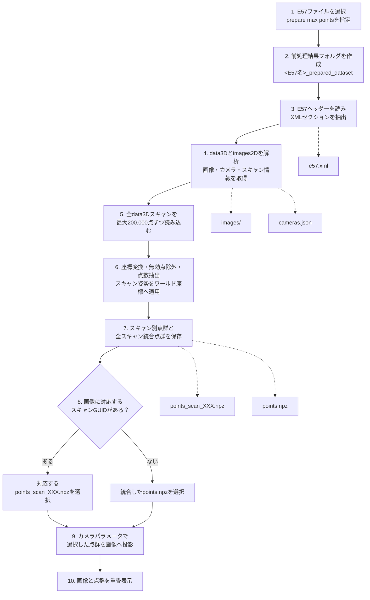

# E57-Image-and-Point-Cloud-Overlay-Viewer

E57ファイルに含まれる点群・画像・pinhole camera情報を読み出し、画像上に点群を重ねて確認するWindows向けViewerです。

## Windows実行ファイルを起動する

配布されたZIPファイルから、次の手順でViewerを起動できます。PythonやCondaのインストールは不要です。

1. 受け取ったZIPファイルを右クリックし、`すべて展開` を選びます。
2. 展開されたプロジェクトフォルダ内の `dist\E57-Image-and-Point-Cloud-Overlay-Viewer` フォルダを開きます。
3. `dist\E57-Image-and-Point-Cloud-Overlay-Viewer\E57-Image-and-Point-Cloud-Overlay-Viewer.exe` をダブルクリックします。アプリケーションは必ず `dist` フォルダ内から起動してください。
4. Viewerが開いたら、`Open E57 and prepare` から表示したいE57ファイルを選択します。

ZIPファイルを開いた状態のままEXEを実行しないでください。また、EXEだけを別の場所へ移動すると起動できません。`_internal` フォルダを含む配布フォルダ全体を同じ場所に置いて使用してください。

「組織のDevice Guardポリシーによってブロックされました」と表示された場合は、セキュリティ設定を変更せず、組織のサポート担当者へViewerの利用許可を依頼してください。

## 主な機能

- `.e57` をGUIから選択して、そのまま前処理・表示
- 画像と点群の重畳表示
- 画像ごとに関連するスキャンの点群を自動選択
- 点群・画像の透明度、点サイズ、表示点数を調整
- 画像上をクリックして、最寄り投影点のXYZ座標を表示
- 前処理済みデータセットの再読み込み
- 画面サイズに合わせたウィンドウ・操作パネルの自動調整
- PyInstallerによるWindows実行ファイルの作成

## 動作環境

- EXE版: Windows 10 / 11（Python・Condaは不要）
- ソースから起動する場合: 64-bit版Windows 10 / 11、Anaconda または Miniconda
- 初回セットアップ時にパッケージを取得できるインターネット接続
- E57ファイルと前処理結果を保存できる空き容量

## リポジトリを取得する

GitHubの `Code` ボタンから `Download ZIP` を選んで展開するか、Gitが使える場合は表示されたURLをコピーして次を実行します。

```bat
git clone <コピーしたリポジトリURL>
```

以降の操作は、リポジトリのルート（このREADMEがあるフォルダ）で行います。初めて使う場合は **Anaconda Prompt** を開き、`cd` でこのフォルダへ移動してください。

```bat
cd C:\path\to\e57-fusion-viewer-AIST
```

## ソース版の正式セットアップ手順（初回のみ）

Windowsでソース版を使用する場合は、Win64向けのCondaパッケージを固定した `environment-win64-explicit.txt` から環境を作成します。以下が正式な環境構築手順です。すべてリポジトリのルートで実行してください。

### 1. Conda環境を作成する

```bat
conda create -n e57-fusion-viewer --file environment-win64-explicit.txt
```

### 2. Conda環境を有効化する

```bat
conda activate e57-fusion-viewer
```

### 3. pip依存パッケージをインストールする

`pye57` など、Condaの明示的ロックファイルに含まれないパッケージをインストールします。この手順は省略しないでください。

```bat
python -m pip install -r requirements.txt
```

### 4. Viewerをインストールする

```bat
python -m pip install -e .
```

### 5. Viewerを起動する

```bat
run_viewer.bat
```

2回目以降は、リポジトリのルートで `run_viewer.bat` を実行するだけです。このbatファイルが `e57-fusion-viewer` 環境を有効化してViewerを起動します。

## E57ファイルを表示する

1. Viewer右側の `Open E57 and prepare` を押します。
2. 表示したい `.e57` ファイルを選択します。
3. 前処理が完了するまで待ちます。大きいE57では時間がかかることがあります。
4. 前処理が完了すると、最初の画像と点群が自動的に表示されます。
5. `Image` のプルダウンから別の画像へ切り替えます。

前処理結果は、元のE57ファイルと同じ場所に次の名前で作成されます。

```text
<E57ファイル名>_prepared_dataset\
  cameras.json
  e57.xml
  images\
  points.npz
  points_scan_000.npz  （各スキャンの点群）
  points_scan_001.npz  （スキャンが複数ある場合）
  ...
```

同じE57を再度確認するときは `Open prepared dataset` を押し、上記の `_prepared_dataset` フォルダを選択すると、前処理を省略できます。

## E57前処理の内容

`Open E57 and prepare` を実行すると、元のE57ファイルと同じ場所に前処理結果フォルダを作成し、次の2段階を順番に実行します。



各処理の詳しい説明は、[初心者向けE57前処理ガイド](docs/e57-preprocessing-guide.md)を参照してください。

### 1. 画像とカメラ情報を抽出する

`tools\extract_images_from_e57_xml.py` が次の処理を行います。

1. E57ヘッダーを読み取り、ページ末尾のチェックサム領域を除外しながらXMLセクションを `e57.xml` として抽出します。
2. XMLの `data3D` から、各スキャンのGUID、名前、回転、平行移動を読み取ります。
3. XMLの `images2D` から、姿勢とpinhole camera情報を持つJPEGまたはPNG画像を抽出します。
4. 焦点距離、画素寸法、画像サイズ、主点から投影用の内部パラメータを整理します。
5. `associatedData3DGuid` がある画像は対応するスキャンへ関連付け、使用する `points_scan_XXX.npz` を決定します。関連付けがない画像は統合点群の `points.npz` を使用します。
6. 画像を `images` フォルダへ保存し、カメラ情報と相対ファイルパスを `cameras.json` へ保存します。

`cameras.json` の `source_e57` と `source_xml` にはファイル名だけを記録します。ユーザー名などを含むローカルの絶対パスは保存しません。

### 2. 点群を変換する

`tools\convert_points_with_pye57.py` が次の処理を行います。

1. E57内のすべての `data3D` スキャンを順番に読み込みます。
2. Cartesian座標はそのまま使用し、Spherical座標はXYZへ変換します。不正点フラグがある点は除外します。
3. RGBとintensityが記録されている場合は、XYZとあわせて読み込みます。
4. 大きなスキャンを一度にメモリへ展開せず、最大200,000点ずつ分割して読み込みます。
5. 点数が `prepare max points` を超えるスキャンは、固定シードを使って再現可能なランダム抽出を行います。
6. スキャンに姿勢情報がある場合は回転と平行移動を適用し、共通のワールド座標へ変換します。
7. 各スキャンを `points_scan_XXX.npz` へ保存します。さらに全スキャンを統合し、必要に応じて再度 `prepare max points` まで抽出して `points.npz` へ保存します。

NPZファイルには `xyz` を必ず保存し、元データに存在する場合だけ `rgb` と `intensity` も保存します。GUIの `prepare max points` の初期値は500,000点です。

## 画面の設定項目

| 項目 | 説明 |
| --- | --- |
| `point alpha` | 点群の透明度を変更します。 |
| `image alpha` | 背景画像の透明度を変更します。 |
| `point size` | 描画する点の大きさを変更します。 |
| `max overlay points` | 画像に重ねて描画する点数の上限です。値を増やすと密になりますが、描画が重くなります。 |
| `prepare max points` | E57の各スキャンから前処理時に保存する点数の上限です。値を増やすと精細になりますが、処理時間と使用メモリが増えます。 |

画像上をクリックすると、クリック位置から15 px以内にある最寄り投影点のXYZ座標が右側に表示されます。

## 別の起動方法

Pythonモジュールとして直接起動することもできます。

```bat
conda activate e57-fusion-viewer
set PYTHONPATH=%CD%\src
python -m e57_fusion_viewer.main
```

前処理済みデータセットを起動時に開く場合は、フォルダのパスを引数に指定します。

```bat
python -m e57_fusion_viewer.main "C:\path\to\sample_prepared_dataset"
```

## 既存環境を更新する

ソースコードまたはpip依存パッケージだけが更新された場合は、次を実行します。

```bat
conda activate e57-fusion-viewer
python -m pip install -r requirements.txt
python -m pip install -e .
```

`environment-win64-explicit.txt` が更新された場合や環境が壊れた場合は、既存環境を削除し、「ソース版の正式セットアップ手順」に従って作り直してください。環境内に独自に追加したパッケージも削除されるため、必要な場合は事前に記録してください。

```bat
conda deactivate
conda env remove -n e57-fusion-viewer
conda create -n e57-fusion-viewer --file environment-win64-explicit.txt
conda activate e57-fusion-viewer
python -m pip install -r requirements.txt
python -m pip install -e .
```

`install_v8.bat` でもViewerを再インストールできます。ただし、先に正式手順で `e57-fusion-viewer` 環境を作成し、pip依存パッケージをインストールしておく必要があります。

## トラブルシューティング

### `conda` が認識されない

通常のコマンドプロンプトではなく **Anaconda Prompt** を使用してください。それでも認識されない場合は、AnacondaまたはMinicondaがインストールされているか確認してください。

### `EnvironmentNameNotFound: Could not find conda environment: e57-fusion-viewer` と表示される

Conda環境がまだ作成されていません。リポジトリのルートで次を実行してください。

```bat
conda create -n e57-fusion-viewer --file environment-win64-explicit.txt
conda activate e57-fusion-viewer
python -m pip install -r requirements.txt
python -m pip install -e .
```

### `ModuleNotFoundError` が表示される

環境を有効化してViewerを再インストールします。

```bat
conda activate e57-fusion-viewer
python -m pip install -r requirements.txt
python -m pip install -e .
```

### E57の前処理に失敗する

- E57ファイルが他のアプリで使用中でないか確認してください。
- 元のE57と同じフォルダに書き込み権限と十分な空き容量があるか確認してください。
- 大きいE57でメモリ不足になる場合は、GUIの `prepare max points` を小さくして再実行してください。
- 同名の `_prepared_dataset` フォルダが壊れている可能性がある場合は、必要に応じて退避してから再実行してください。

### 点群が表示されない、または画像と位置が合わない

画面右下のステータスで、投影点数と使用中の `points*.npz` を確認してください。E57の出力元によって、カメラ姿勢・座標軸・画像とスキャンの関連付けの記録方法が異なる場合があります。その場合、ファイルは読み込めても正しく重ならないことがあります。

このViewerの投影は、検証済みのPentax E57サンプルに合わせて次の規約を使用します。

- カメラ姿勢: camera-to-world
- カメラ前方: `-Z`
- カメラ座標の上方向: `+Y`
- 画像座標の下方向: `+V`
- 主点: E57に記録された `principalPointX` / `principalPointY` を保持

手動で投影規約や主点を補正する機能はありません。別の規約で出力されたE57では、出力元の仕様確認または変換処理が必要です。

## 開発者向け：ビルド方法

ソースから配布用フォルダを作成する場合に使用します。ビルド用PCには64-bit版Python 3.11が必要です。`build_exe.bat` は利用可能なPythonを自動検出し、通常はリポジトリ内にビルド専用の `.build-venv` を作成して、必要なパッケージのインストールからPyInstallerの実行まで行います。

```bat
build_exe.bat
```

新しく `.build-venv` を作成する場合、初回ビルドではパッケージをダウンロードするためインターネット接続が必要です。2回目以降は正常な `.build-venv` を再利用します。

ビルド完了時には、Viewer本体、QtのWindows用プラグイン、E57前処理ツール、pye57のネイティブモジュールが含まれていることを静的に確認します。これらの確認に失敗した場合は、配布可能なビルドとして成功扱いにはなりません。

生成したEXEを使った依存関係テストは、次のように明示的に有効化できます。組織のDevice Guardなどが未署名EXEの実行を制限しているPCでは、このテストを有効にしないでください。

```bat
set E57_RUN_EXE_SMOKE_TEST=1
build_exe.bat
```

成功すると、次の配布用フォルダが作成されます。

```text
dist\E57-Image-and-Point-Cloud-Overlay-Viewer\
  E57-Image-and-Point-Cloud-Overlay-Viewer.exe
  _internal\
```

生成物の配布・起動方法は、README冒頭の「Windows実行ファイルを起動する」を参照してください。

## 依存関係ファイルの位置付け

- `environment-win64-explicit.txt`: 正式セットアップで使用するWin64向けConda明示的ロックファイル
- `requirements.txt`: Conda環境の作成後に必ずインストールするpip依存パッケージ
- `environment-minimal.yml`、`environment.yml`: 依存関係の保守・参照用。正式セットアップには使用しません
