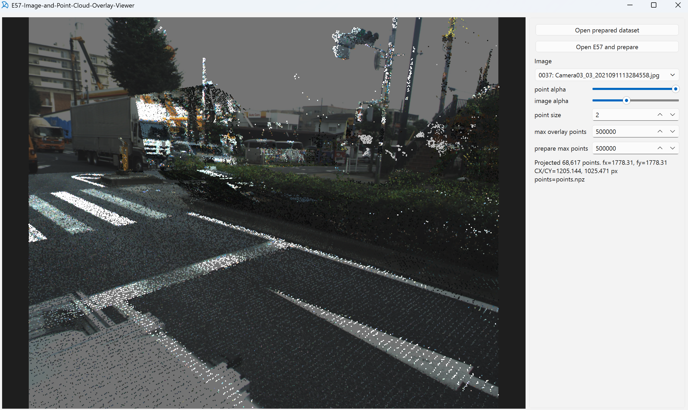
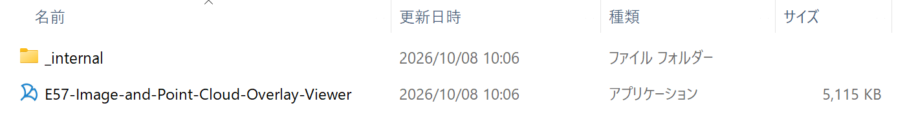
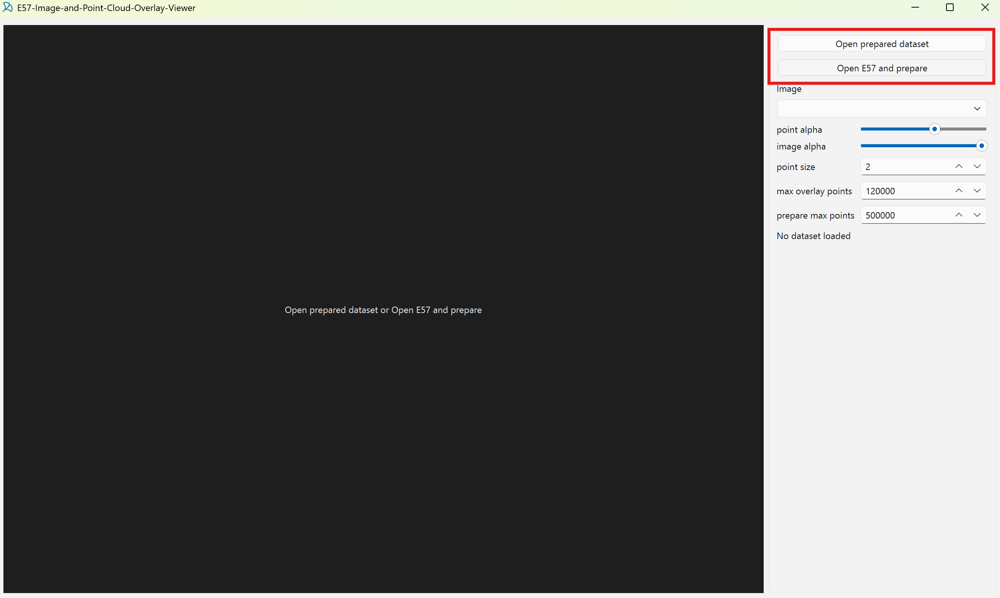

# E57-Image-and-Point-Cloud-Overlay-Viewer

[English](README.md) | **日本語**



E57ファイルに含まれる点群・画像・カメラ情報を読み出し、画像上に点群を重ねて確認するWindows向けビューアーです。

## プロジェクト構成

```text
.
├── README.md                  英語の利用方法とプロジェクト概要
├── README_JP.md               日本語の利用方法とプロジェクト概要
├── run_viewer.bat             ソース版の起動
├── pyproject.toml             Pythonパッケージ定義
├── src/e57_fusion_viewer/     ビューアー本体・投影処理
├── tools/                     E57の画像抽出・点群変換
├── env/                       環境構築・配布用ビルド
│   ├── install.bat
│   ├── build_exe.bat
│   ├── requirements.txt
│   ├── environment-win64-explicit.txt
│   ├── environment.yml
│   ├── viewer.spec
│   └── run_viewer_packaged.py
├── assets/                    アプリケーションの画像素材
└── docs/                      各種ガイド・README掲載画像
```

`env` には環境の定義・構築用ファイルを格納しています。Conda環境の本体はCondaの管理先に作成されます。

## 主な機能

- E57ファイルを画面から選択し、画像・カメラ情報・点群の前処理から表示まで実行
- 画像に関連付けられたスキャンの点群を自動選択して重畳表示
- 点群と画像の透明度、点サイズ、表示点数を調整
- 画像上をクリックして、最寄り投影点のXYZ座標を表示
- 前処理済みデータセットを再利用して読み込み時間を短縮

## Windows実行ファイルから起動する

対応OSはWindows 10 / 11（64-bit）です。PythonやCondaのインストールは不要です。

1. [Releases](https://github.com/imvisionlabs/E57-Image-and-Point-Cloud-Overlay-Viewer-AIST/releases) の `Assets` からWindows用ZIPをダウンロードします。v0.8.0の場合は `e57-overlay-viewer-0.8.0-windows-x64.zip` です。
2. ダウンロードしたZIPを右クリックし、`すべて展開` を選びます。
3. 展開先の `E57-Image-and-Point-Cloud-Overlay-Viewer` フォルダを開きます。
4. `E57-Image-and-Point-Cloud-Overlay-Viewer.exe` をダブルクリックします。

   拡張子が非表示の場合は、末尾の `.exe` が表示されません。種類が「アプリケーション」のファイルを選んでください。

   

5. 画面右上の `Open E57 and prepare` を押し、表示したいE57ファイルを選びます。

   

EXEと `_internal` フォルダは同じ場所に置いてください。EXEだけを取り出すと起動できません。`Assets` の `Source code (zip)` はソースコード用で、Windows実行ファイルは含まれません。

「組織のDevice Guardポリシーによってブロックされました」と表示された場合は、組織のサポート担当者へ利用許可を依頼してください。

## ソースから起動する

64-bit版Windows 10 / 11とAnacondaまたはMinicondaを使用します。初回セットアップにはインターネット接続が必要です。

ソースを取得・展開した後、**Anaconda Prompt** でこのREADMEがあるフォルダに移動し、次を実行してください。

```bat
conda create -n e57-fusion-viewer --file env\environment-win64-explicit.txt
env\install.bat
run_viewer.bat
```

`env\install.bat` は作成済みのConda環境を有効化し、依存パッケージとビューアーをインストールします。2回目以降は `run_viewer.bat` で起動できます。

手動でのセットアップ、環境の更新、起動エラーへの対処は [環境構築ガイド](docs/setup.md) を参照してください。

## E57ファイルを表示する

1. 画面右側の `prepare max points` で、前処理時に保存する点数の上限を指定します。初期値は500,000点です。
2. `Open E57 and prepare` を押し、対象の `.e57` ファイルを選びます。
3. 前処理が完了すると、最初の画像と点群が表示されます。大きいE57では処理に時間がかかることがあります。
4. `Image` のプルダウンから表示する画像を切り替えます。

元のE57ファイルは変更しません。前処理結果は、E57と同じ場所に次の構成で保存します。保存先には書き込み権限と十分な空き容量が必要です。

```text
<E57ファイル名>_prepared_dataset/
├── cameras.json
├── e57.xml
├── images/
├── points.npz
├── points_scan_000.npz
└── points_scan_001.npz   （スキャンが複数ある場合）
```

同じE57を再度表示するときは、`Open prepared dataset` からこのフォルダを選択すると、前処理を省略できます。

### 画面の設定項目

| 項目 | 説明 |
| --- | --- |
| `point alpha` | 点群の透明度を変更します。 |
| `image alpha` | 背景画像の透明度を変更します。 |
| `point size` | 描画する点の大きさを変更します。 |
| `max overlay points` | 画像に重ねて描画する点数の上限です。値を増やすと密になりますが、描画が重くなります。 |
| `prepare max points` | 前処理で保存する各スキャンと統合点群の点数の上限です。値を増やすと精細になりますが、処理時間と使用メモリが増えます。 |

画像上をクリックすると、クリック位置から15 px以内にある最寄り投影点のXYZ座標が右側に表示されます。

### 前処理の概要

1. E57からXML・画像・カメラ情報を抽出します。
2. 点群を最大200,000点ずつ読み込み、無効点の除外・点数の抽出・ワールド座標への変換を行います。
3. スキャン別点群と統合点群を保存します。
4. 画像に対応する点群を選び、カメラ情報に基づいて投影します。

対応スキャンの関連付けがない画像には、統合点群の `points.npz` を使用します。処理の詳細と座標変換の説明は [E57前処理ガイド](docs/e57-preprocessing-guide.md) を参照してください。

### 表示・前処理のトラブル

**前処理に失敗する場合**は、E57ファイルが他のアプリで使用中でないか、保存先に書き込み権限と空き容量があるかを確認してください。メモリ不足の場合は `prepare max points` を小さくして再実行します。前処理途中のフォルダが残っている場合は、必要に応じて退避してから再実行してください。

**点群が表示されない、または画像と位置が合わない場合**は、画面右側の投影点数と使用中の `points*.npz` を確認してください。E57の出力元によって、カメラ姿勢・座標軸・スキャンとの関連付けの記録方法が異なるため、正しく重ならない場合があります。

本ビューアーの投影は、検証済みのPentax E57サンプルに合わせた次の規約を使用します。

- カメラ姿勢：camera-to-world
- カメラ前方：`-Z`、カメラ座標の上方向：`+Y`
- 画像座標の下方向：`+V`
- 主点：E57に記録された `principalPointX` / `principalPointY` を使用

対象画像は、姿勢情報とpinhole camera情報を持つJPEGまたはPNGです。投影規約や主点の手動補正機能はありません。異なる規約のE57では、出力元の仕様確認または変換処理が必要です。

## 配布用ビルド・技術資料

配布用のWindows実行ファイルは、リポジトリのルートで次を実行して作成します。

```bat
env\build_exe.bat
```

生成先は `dist\E57-Image-and-Point-Cloud-Overlay-Viewer` です。フォルダ全体を配布してください。

- [環境構築ガイド](docs/setup.md)：初回セットアップ、更新、依存関係ファイル、起動エラーへの対処
- [配布用ビルドガイド](docs/build.md)：ビルド環境、生成物、検証方法
- [E57前処理ガイド](docs/e57-preprocessing-guide.md)：画像抽出、点群変換、カメラ投影

## ライセンス

Copyright 2026 National Institute of Advanced Industrial Science and Technology (AIST).

著作権者は国立研究開発法人産業技術総合研究所（産総研）です。
別途表示がある場合を除き、自作コード・スクリプト・設定ファイル・自作文書には
[Apache License 2.0](LICENSE)を適用します。ロゴ・商標・画像素材・スクリーンショットに
写るデータは、この許諾の対象外です。第三者ソフトウェアには、それぞれのライセンスが適用されます。
同梱部品の表示とQt／PySide6のLGPLv3対応ソース・差し替え方法は
[第三者ソフトウェアの説明](THIRD_PARTY_NOTICES.md)を参照してください。
