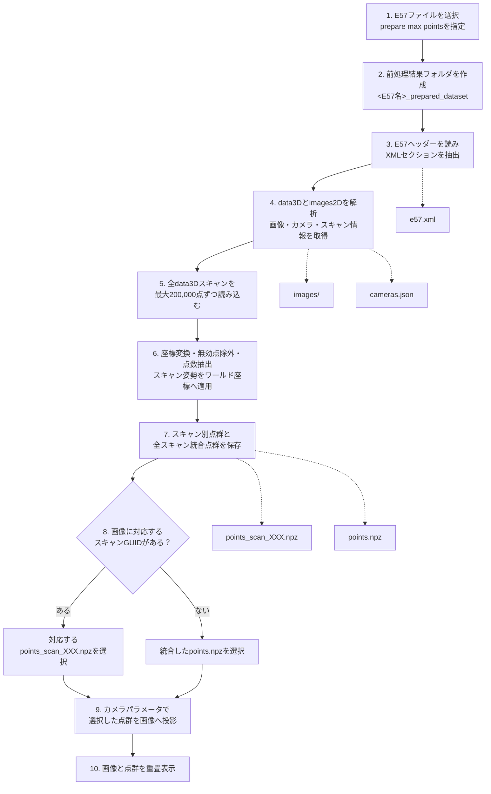

# E57前処理ガイド

E57は、点群・画像・カメラ情報などを1つにまとめたファイルです。このViewerの前処理では、E57をViewerが高速に読み込める画像、カメラ情報、点群ファイルへ分解します。

手順1〜7が前処理、手順8〜10がViewerで表示するときの処理です。

## 全体の流れ



## 用語

- 点群：多数のXYZ座標で表現された3D形状です。
- スキャン：レーザースキャナーで1回取得した点群のまとまりです。
- 姿勢：位置と向きです。回転と平行移動で表現します。
- GUID：スキャンや画像を識別するためのIDです。
- カメラ内部パラメータ：焦点距離や主点など、3D点を画像上へ写すための情報です。
- ワールド座標：複数スキャンで共通して使用する3D座標です。
- 投影：3D座標を画像上の2D座標へ変換することです。

## 1. E57ファイルを選択する

Viewerの `Open E57 and prepare` から対象のE57ファイルを選びます。

同時に、GUIの `prepare max points` で保存する点数の上限を指定します。初期値は500,000点です。

値を小さくすると、前処理結果が小さくなり、Viewerの読み込みや描画も軽くなります。一方で点群が粗くなり、細かな形状が減ります。

前処理で元のE57ファイルを変更することはありません。

## 2. 前処理結果フォルダを作成する

元のE57と同じ場所に次のフォルダを作成します。

```text
<E57ファイル名>_prepared_dataset\
```

例えば `building.e57` を選択した場合は次のようになります。

```text
building.e57
building_prepared_dataset\
```

前処理の途中で失敗した場合は、作成途中のファイルが残ることがあります。

## 3. E57からXMLを抽出する

E57には、点群のバイナリデータ、JPEGまたはPNG画像、スキャンやカメラのメタデータ、それぞれの保存位置を示すXMLがまとめて入っています。

最初にE57ファイル先頭の48バイトのヘッダーを読みます。ヘッダーには、XMLの位置、長さ、ページサイズなどが記録されています。

E57はページ単位で保存され、各ページの末尾4バイトにはチェックサムがあります。チェックサムはデータ破損を検出するための情報であり、XML本文ではありません。スクリプトはチェックサムを飛ばしながらXMLを読み出し、次のファイルへ保存します。

```text
e57.xml
```

この処理は `tools\extract_images_from_e57_xml.py` が行います。

## 4. スキャン・画像・カメラ情報を解析する

抽出したXMLの `data3D` と `images2D` を解析します。

### `data3D`

各スキャンについて次の情報を読みます。

- スキャン番号
- GUID
- 名前
- 回転
- 平行移動

回転と平行移動は、そのスキャンの点群をワールド座標へ移すために使用します。

### `images2D`

各画像について次の情報を読みます。

- JPEGまたはPNG画像
- 画像サイズ
- 焦点距離
- 1画素の物理サイズ
- 主点
- カメラの位置と向き
- 対応するスキャンのGUID

焦点距離と画素サイズから、投影に使う `fx` と `fy` を計算します。主点は `cx` と `cy` として保存します。

現在のViewerが処理するのは、姿勢情報とpinhole camera情報を持つJPEGまたはPNG画像です。必要な情報がない画像は投影対象になりません。

画像本体はE57のBlob領域から取り出して `images` フォルダへ保存します。

```text
images\
  0000_<画像名>.jpg
  0001_<画像名>.jpg
```

解析したカメラ情報は `cameras.json` へ保存します。画像パスなどは前処理結果フォルダからの相対パスです。`source_e57` と `source_xml` にはファイル名だけを記録し、ユーザー名を含む絶対パスは保存しません。

## 5. 全スキャンの点群を読み込む

`tools\convert_points_with_pye57.py` が `pye57` を使い、E57内のすべての `data3D` スキャンを順番に読みます。

巨大な点群を一度にメモリへ展開すると、メモリ不足や長時間停止の原因になります。そのため、最大200,000点ずつに分けて読み込みます。

各点について、元のE57に存在するデータだけを取得します。

- XYZまたは球面座標
- 無効点フラグ
- RGB
- intensity

分割読み込みによってメモリ使用量は抑えられます。ただし、点数を減らす場合でもE57全体を順番に読むため、入力ファイルが大きいと前処理には時間がかかります。

## 6. 点群を共通のXYZ座標へ変換する

E57の点群にはCartesian座標とSpherical座標があります。

### Cartesian座標

最初から `X`、`Y`、`Z` で保存されているため、そのまま使用します。

### Spherical座標

距離、方位角、仰角で保存されているため、CartesianのXYZ座標へ変換します。

座標変換後、無効点フラグが付いている点を除外します。

点数が `prepare max points` を超える場合は、点群全体からランダムに抽出します。固定シードを使用するため、同じE57と同じ設定であれば基本的に同じ点が選ばれます。無効点の除外によって、最終的な点数が設定値より少なくなる場合があります。

最後に、スキャンの回転と平行移動を適用します。

```text
スキャン固有の座標
        ↓
共通のワールド座標
```

これにより、異なる位置から取得した複数スキャンを同じ3D空間へ配置できます。

## 7. NPZファイルへ保存する

各スキャンは個別に保存します。

```text
points_scan_000.npz
points_scan_001.npz
...
```

さらに、すべてのスキャンを結合した点群も作成します。

```text
points.npz
```

統合後の点数が `prepare max points` を超える場合は、統合点群からもう一度抽出します。

例えば500,000点を指定した場合、各 `points_scan_XXX.npz` と統合した `points.npz` はそれぞれ最大500,000点になります。

NPZには次の配列を保存します。

- `xyz`：必ず保存します。
- `rgb`：元のE57に色がある場合だけ保存します。
- `intensity`：元のE57に強度がある場合だけ保存します。

現在のViewerは主に `xyz` と `rgb` を表示に使用します。`intensity` はNPZに保存されますが、表示色としてはまだ使用していません。

## 8. 画像に対応する点群を選ぶ

Viewerは `cameras.json` の `associatedData3DGuid` を確認します。

画像と特定のスキャンが関連付けられている場合は、そのスキャンの点群を使用します。

```text
画像
  ↓
points_scan_XXX.npz
```

関連付けが記録されていない場合は、すべてのスキャンを統合した点群を使用します。

```text
画像
  ↓
points.npz
```

関連付けがない画像でも表示できますが、関係のないスキャンの点が含まれる可能性があります。

## 9. 3D点を画像上へ投影する

点群はワールド座標、カメラは位置と向きを持っています。まず、ワールド座標の点をカメラから見た座標へ変換します。

```text
ワールド座標
    ↓ カメラ姿勢の逆変換
カメラ座標
```

このViewerではカメラ前方を `-Z` としています。カメラの後ろにある点や、画像範囲の外側に投影される点は表示対象から除外します。

残った点を、`fx`、`fy`、`cx`、`cy` を使って画像のピクセル座標へ変換します。

```text
3D座標 X, Y, Z
        ↓
画像座標 U, V
```

これが、3D点群を2D画像上へ写す投影処理です。

## 10. 画像と点群を重ねて表示する

最後に画像を背景として表示し、その上に投影した点を描画します。

GUIでは次の項目を変更できます。

- `point alpha`：点群の透明度
- `image alpha`：画像の透明度
- `point size`：点の大きさ
- `max overlay points`：画面へ描画する点数
- `prepare max points`：前処理で保存する点数

画像上をクリックすると、クリック位置から15ピクセル以内にある最寄りの投影点を探し、元のXYZ座標を表示します。

## 生成されるファイル

```text
<E57ファイル名>_prepared_dataset\
  cameras.json
  e57.xml
  images\
  points.npz
  points_scan_000.npz
  points_scan_001.npz
  ...
```

同じE57を再度表示するときは `Open prepared dataset` からこのフォルダを選択すると、前処理を省略できます。
